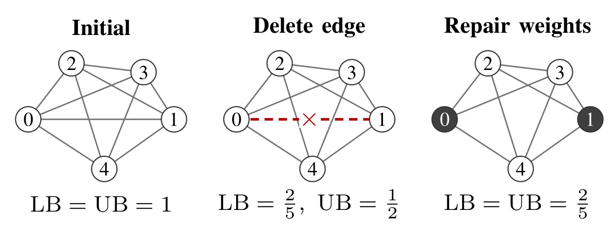
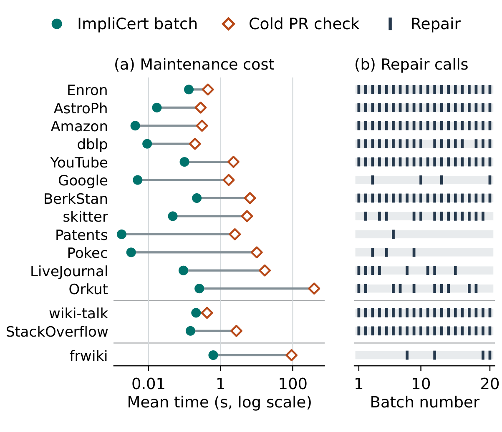

# ImpliCert

*Implicit Certificates for Batch-Dynamic k-Clique Densest Subgraphs Without Materializing Cliques*

Deleting one edge from a five-vertex clique destroys three of its five four-cliques. ImpliCert recovers their shares from vertex potentials. A local repair then brings the maximum load down to the witness density of 2/5.

### Time through independent verification

Mean seconds for all 20 updates of a trace, over three runs. Every batch waits for export and an outward-rounded recount.

| Trace | ImpliCert | Warm global PR | Cold global PR |
|---|---:|---:|---:|
| dblp | **15.06** | 17.70 | 18.91 |
| wiki-talk | 30.29 | 45.86 | **29.06** |

Figure 2 · Numerical batch latency, cold checkpoint solves and repair triggers

Check the pictured deletion with Python 3.10+:

~~~sh
python verify_certificate.py data/before.json data/after.json
~~~

For the native strict replay on x64 Windows, run `build.cmd` with Visual Studio C++ Build Tools and LLVM OpenMP installed, then `python run_strict_example.py`.
