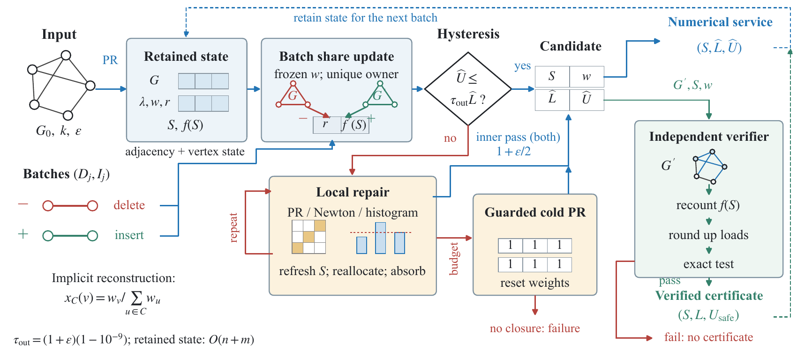
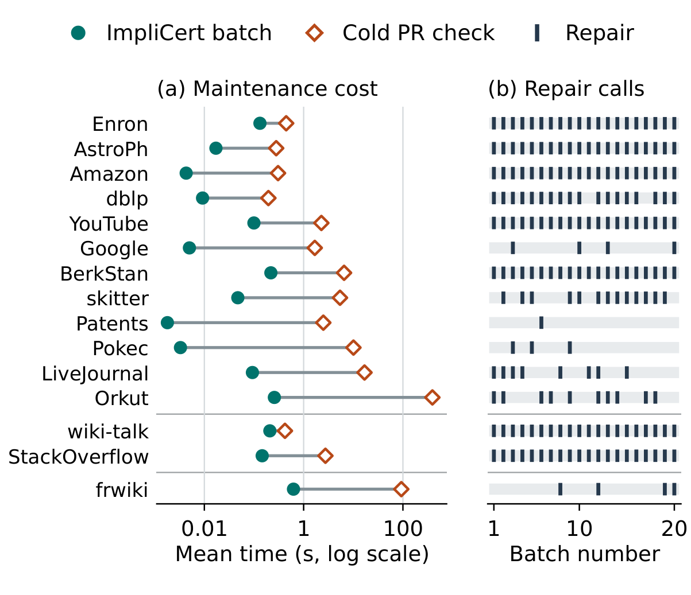

# ImpliCert

Implementation of *Implicit Certificates for Batch-Dynamic k-Clique Densest Subgraphs Without Materializing Cliques*.



## Verify a deletion

With Python 3.10 or later, verify the archived states before and after one edge deletion:

```sh
python verify_certificate.py data/before.json data/after.json
```

The checker enumerates the four-cliques independently. The witness density and maximum load agree at 1 before deletion and at 2/5 after deletion.

## Batch replay

On x64 Windows with Visual Studio C++ Build Tools and LLVM OpenMP:

```powershell
.\build.cmd
python run_strict_example.py
```

The example checks incremental maintenance, warm global repair and cold global repair on a small shared trace. The published full-input results below are means over three runs and include checkpoint export and independent verification after every update. [dblp and wiki-talk timings](data/strict-service.csv) · [Amazon, Enron and web-Google timings](data/strict-extension-runs.csv)

| Trace | ImpliCert (s) | Warm global PR (s) | Cold global PR (s) |
|---|---:|---:|---:|
| dblp | **15.06** | 17.70 | 18.91 |
| wiki-talk | 30.29 | 45.86 | **29.06** |
| Amazon | **16.74** | 24.75 | 23.26 |
| Enron | **14.89** | 25.96 | 21.53 |
| web-Google | **39.10** | 46.76 | 74.75 |

<details>
<summary>Numerical batch latency and repair frequency</summary>



</details>

## Reproduce the experiments

```powershell
python -m pip install -r requirements.txt
python tools/build.py all
python tools/baselines.py all --cxx C:/toolchains/mingw64/bin/g++.exe
python tools/validate_release.py --baselines --real-data
```

[Reproduction commands](docs/reproduction.md) cover the main workloads, warm/cold PR, external baselines, ablations, parameter sweeps and strict service. [Experiment mapping](docs/experiments.md) separates archived numerical results from guarded reruns and independently verified checkpoints. [Release validation](docs/validation.md) records a clean build and complete integration checks. The full artifact requires x64 Windows, Python 3.12+, MSVC with LLVM OpenMP and WinLibs GCC; no GPU is needed.
